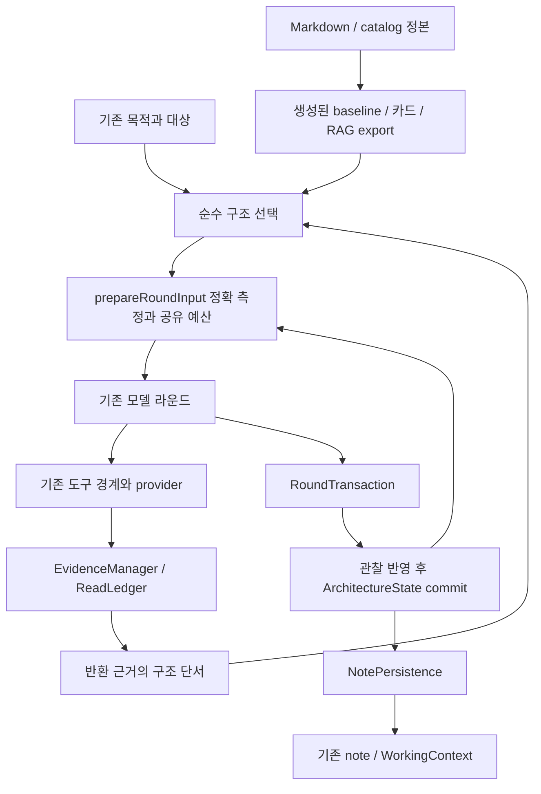

# Unreal 구조 판단 기능 구현 결과 — 2026-10-28

## 상태와 범위

- 기준: `2b13b38c5644b9072e04c488e642205b46cbc804`, `codex/harness-output-contract-fixes`.
- [실행 명세](Harness_Architecture_Awareness_SOL_Spec_20261028.md)의 하네스·컴팩터·RAG 변경을 작업 트리에 구현했다. 제품 버전은 compactor 0.4.86 / Unreal Agent 0.3.32 그대로다.
- 실제 Unreal 사용자 프로젝트는 수정하지 않았다. 현재 작업은 설치·커밋·병합·배포되지 않은 소스 변경이다.
- 계약의 결정적 검사는 아래 결과로 기록한다. 실제 모델의 의미 품질과 재조회 감소 효과는 별도 상태다.
- 근거 기록: [구현 근거 패킷](evidence/architecture-awareness-implementation-20261028.json). 패킷 검사는 형식과 기록 일관성만 확인한다.

## 사용자에게 달라지는 동작

기존 Design references가 **Auto이고 Unreal 대상이 확인된 코드 작업**이면 별도 구조 검토 요청 없이 소유자, 필요한 수명, 공유 범위, 정의 데이터와 실행 상태를 비교하는 기본 지침을 제공한다. 기본 설정 Off는 유지한다. 설명 요청·수동 모드·Observe only·allowance 0에는 새 자동 구조 상태를 시작하지 않는다.

기존 소유자가 적절한 경우 유지한다. 이미 반환된 소스의 단서와 현재 작업 목적에 따라 최대 두 패턴 카드를 비교 자료로 제공한다. 단서는 어휘 기반 가설이며 클래스 이름이나 파일 길이로 설계 결함을 확정하지 않는다. 패턴 본문에는 적용·비적용, 소유권, 생성·연결·실패·해제, 비용과 반대 근거를 포함했다.

구조 판단을 선택적으로 note v2에 보존할 수 있다. 사용자가 보는 답변에는 내부 footer를 표시하지 않는다. 판단이 selected여도 실행 완료·사실 확인·편집 승인을 의미하지 않는다.

## 책임과 정본

| 정보/행동 | 담당 | 계약 |
| --- | --- | --- |
| 목적·대상·도구 권한 | 기존 TaskObjective / tool scope / guard / provider | 구조 판단은 승인·receipt·CAS를 만들지 않는다 |
| 최근 직접 관찰 버전과 무효화 | 기존 ReadLedger.sourceObservations | 보관본·검색 결과는 최신 직접 관찰 버전을 갱신하지 않는다 |
| 본문 전달·현재 입력의 가용성 | 기존 ReadLedger / EvidenceManager | 전달 여부와 현재 소스 적용성은 서로 다른 정보다 |
| 구조 단서 | architecture-observation | 이미 반환된 본문의 제한된 순수 투영, 디스크·네트워크 접근 없음 |
| 비교 깊이와 카드 후보 | architecture-policy | 순수 선택, 실제 설계안 채택·도구 실행 없음 |
| 실행 중 구조 판단과 revision | ArchitectureState | 실행 하나가 소유하는 reducer, 본문 캐시·영속 저장·도구 세션 소유 없음 |
| 실제 모델 입력과 handle 발급 | prepareRoundInput / architecture-input | 최종 입장한 모델 입력에만 발급, 공유 allowance와 기존 읽기 예약 사용 |
| footer·저장 DTO 형식 | architecture-note-contract | JS parser와 TS 상태가 같은 제한값·validator 사용 |
| 판단 저장·복원 우선순위 | 기존 NotePersistence | history 우선/window fallback, 단일 mirror 경로 |
| 패턴 저작 내용·메타데이터 | Markdown + catalog.json | TypeScript 번들과 RAG export를 같은 생성기에서 파생 |
| RAG 세대·프로젝트 경계 | 기존 collector / builder / request binding | 패턴 지식은 프로젝트 소스나 엔진 API 검증으로 승격하지 않는다 |
| 코드 finding와 보고 누락 | 기존 ReviewRegister | 구조 대안 상태를 finding으로 중복 저장하지 않는다 |

SOLID 관점에서 정책·관찰·판단·입장·영속화를 다른 변경 이유로 나눴다. 기존 도구의 결과 계약과 예산·승인 포트를 재사용하고, 구조 모듈이 파일 읽기·모델 호출·저장을 직접 시작하지 않도록 했다. 구형 인덱스/메타데이터는 unknown으로 취급하며 새 필수 preflight를 추가하지 않았다. 새로운 패턴 추가는 catalog/Markdown과 생성 결과의 변경으로 처리한다.

## 연결과 수명

1. NotePersistence가 기존 우선순위로 note를 복원한다. 활성 조건을 만족하면 실행 하나의 ArchitectureState를 만들고 복원 판단을 historical로 낮춘다.
2. EvidenceManager가 기존 도구 결과의 출처와 직접 관찰 버전을 제공한다. 구조 투영과 선택 정책은 별도 조회를 시작하지 않는다.
3. 최종 입력의 optional admission을 통과한 reference view만 해당 modelInputId의 evidence/pattern handle과 decision revision을 발급한다. 저장 note 전체는 기본 입력으로 새지 않는다.
4. 모델의 일반 note 변경과 구조 patch를 분리한다. 부분 구조 patch의 누락은 삭제가 아니다. 실제 입력에 없던 판단 ID의 수정·퇴역과 미발급 참조는 거부한다.
5. 도구 결과와 소스 변경을 먼저 반영한다. 완료된 planning만 구조 patch를 commit한다. 불확실한 쓰기는 모델 판단의 commit 성공 여부와 독립적으로 기존 관찰을 무효화한다.
6. semantic summary는 일반 note만 보고 반환한다. 구조 영역을 덮어쓰거나 WorkingContext.note에 직접 쓰지 않는다.
7. 기존 종료 경로가 저장·seal·archive release를 맡고, finally에서 새 구조 상태를 닫는다. 구조 상태가 provider나 archive를 따로 닫지 않는다.

| 사건 | 결과 |
| --- | --- |
| 같은 소스의 새 직접 읽기 | 최신 직접 관찰 버전 갱신, 이전 판단의 의존 버전 비교 |
| 관찰된 쓰기/같은 배치의 순서 불명 | 의존 판단 stale/unknown, 같은 입력에서 발급한 옛 참조 commit 거부 |
| 경로 없는 결과 불명 쓰기 | 본문 전달 목록에서 빠진 항목까지 관찰 map 전체 무효화 |
| 보관본 재전달/검색 hit | 가용성 기록만 갱신, 직접 관찰 버전/무효화 복구 금지 |
| 관찰 map 축출 | 현재 버전 미확인, 과거 본문으로 복원하지 않음 |
| 저장 창/새 실행/fork | 판단 historical, mutable 상태 공유 없음 |
| 프로젝트·목적·lineage 변경 | 기존 판단 제외 |
| 엔진 적용성 변경 | 판단 unknown, 같은 라운드의 옛 binding 거부 |
| catalog 변경 | 패턴 의존 판단 stale |
| 취소/불완전 planning/늦은 callback | 새 판단 commit 없음, 반환 근거와 불확실 효과는 기존 계약으로 보존 |
| 저장 예산 초과 | patch 거부 또는 기존 일반 note를 유지한 host snapshot 보존, 구조 영역 조용한 유실 금지 |

## 패턴과 RAG

16개 카드를 추가했다: Component 조합, 독립 Actor, 범위별 Subsystem, 정의/인스턴스 분리, 데이터 fragment, asset 로딩, async 수명, timer/delegate, gameplay framework 역할, interface/strategy, UI 관찰, 상태 전이, 풀 재사용, GAS, Game Features, Blueprint/C++ 소비자 경계.

이 카드는 일반 개념 비교 자료다. 현재 설치 엔진의 API를 검증했다는 뜻이 아니므로 validatedApiVersions는 비워 둔다. 구체 API 조언은 기존 엔진 근거 경로가 필요하다.

- 생성기가 카드와 catalog의 정규화 hash를 만든다. Python 수집기는 동일 hash를 검증한다.
- export-only 수집과 기존 raw_guidelines 갱신을 지원한다. 실패하면 atomic 교체 전의 정상 raw 파일을 보존한다.
- canonical patternId당 한 행으로 관리하고 같은 빌드에서 혼합 버전·불완전 catalog를 거부한다.
- architecture_pattern은 일반 지식이며 project/engine evidence count를 올리지 않는다.
- corpus 상태를 같은 generation에 연결한다. 구형 manifest 없음=unknown, count 0=no_pattern_corpus, 포함된 corpus에서 검색 실패=no_match를 구분한다.
- 검색 결과와 compact refs에 ID/hash/generation을 보존한다. payload가 작으면 카드 단위로 제외하고 잘린 hash를 발급하지 않는다.
- 검색은 기존 모델 도구 경로를 사용한다. 숨은 호스트 검색·자동 refresh·추가 모델 루프를 넣지 않았다.

## 보고 경계 수정

유일한 한정 이름/leaf 이름의 보고 매칭을 통일했다. 같은 leaf를 가진 서로 다른 소유자는 문맥 없이 함께 해소하지 않으며 부분 문자열을 동일 식별자로 취급하지 않는다.

과거의 “전체 19개” 주장을 명시적으로 철회하고 실제 본문 15개로 정정한 문장은 같은 과장으로 재판정하지 않는다. 정정 후 전체 19개를 다시 현재 사실로 주장하면 기존 범위 경고와 최대 한 번의 도구 없는 보완을 유지한다.

추가 optional 자료 때문에 projection 회차가 달라질 수 있어 retained-guidance 테스트를 기존 midpoint 정책에 맞췄다. compactionRequested인 회차는 low 도달을, 그렇지 않은 projection은 midpoint 이하와 unchanged를 검사한다. 아래 midpoint에서 대화 내용을 더 자르지 않는 제품 정책은 유지했다.

## 검사 결과

최종 결과는 근거 패킷의 verification 항목과 함께 기록한다.

| 검사 | 결과 |
| --- | --- |
| compactor 전체 빌드·테스트 | 1,290 passed / 0 failed |
| Python CI 4개 묶음 | 1,050 passed / 38 skipped / 0 failed |
| Unreal Agent | 375 passed / 2 skipped |
| Unity | 132 passed / 5 skipped |
| 새 결정적 명세 ID | A17 + L13 + N20 + C7 + R13 + Q7 = 77개, 추가 실제 RAG 직렬화 1개 |
| 추가 소유자 경계 | 11개: provider 정규화, 최신 관찰, 쓰기, archive, 축출, 저장 창, scope 등 |
| 실제 production handler replay | 7개: ordinary, same_round_change, cancel, off, note_disabled, malformed, v1_clear |
| guidance/tool/unity/runtime identity 생성 파일 | 일치 검사 통과 |
| 인코딩 / 추가 문서 경로 위생 / 변경 Python 정적 검사 | 1,254개 파일 정상 / 5 passed / Ruff 정상 |
| 반복 gate | 5개 suite × 3회 = 15회 모두 성공 |
| 개발 패키지 smoke | 693개 파일, 금지 파일 0, 새 runtime/카탈로그 포함 확인, sourceTreeClean=false |

replay는 실제 production handler와 가짜 모델/provider를 연결한 결정적 검사다. 이 7개와 소유자별 검사를 §13.1의 모든 복합 시퀀스를 각각 한 번에 재현했다는 주장으로 확대하지 않는다. 일반 모델 응답의 의미 품질이나 실제 사용자 프로젝트의 동작을 증명하지 않는다.

독립 검토에서는 반환 본문과 최신 직접 관찰의 정본 혼동, 전체 무효화의 잘못된 열거 대상, fixture의 도구 목록 공유를 발견했고 수정했다. 이후 집중 검토의 추가 제품 결함은 발견되지 않았다. 이는 출처 권한 경계의 검토 결과이며 전체 제품의 무결성 보증은 아니다.

## 남은 실측과 적용

- LM Studio 조회에서 로드된 모델은 없었다. 같은 모델/quantization/tokenizer/설정/source snapshot으로 진행할 B0–B3의 M01–M12 의미 품질·재조회·지연 비교는 실행하지 않았다.
- 실제 로컬 RAG 인덱스의 갱신과 설치된 런타임 적용은 수행하지 않았다. 새 corpus 포함률은 다음 명시적 정상 build/refresh에서 확인해야 한다.
- 따라서 ContractImplemented=true, DeterministicTestsVerified=true, ModelEvaluated=false, Installed=false로 구분한다. 모델 품질 개선 비율이나 재조회 감소율은 아직 제시할 수 없다.
- 설치 전에는 생성 파일 검사와 동일 source fingerprint의 패키지 검사를 다시 확인한다. 문제가 있으면 Auto를 Off 또는 기존 수동 모드로 전환해 새 구조 평가를 중지할 수 있다. v2 저장 영역은 일반 note와 분리되어 수동 보존된다.

