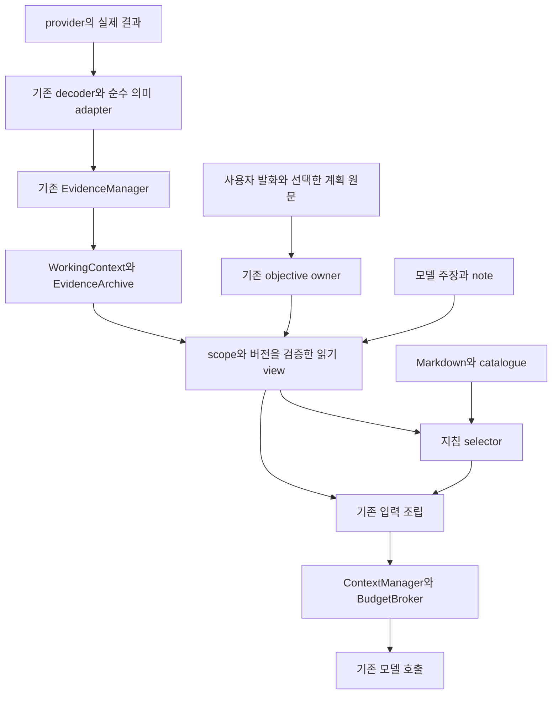

# 실제 작업 실패를 기준으로 한 하네스 행동 개선 계획

작성: 2026-10-07. 개정: 구현 및 회귀 검증 반영. 상태: **W0~W7 제품 구현 / W8 평가 자료 준비, 라이브 평가 미실행**.

실행 순서의 기준은 6절, 추가 재현 결과는 9절, 상세 계약은 10~15절이다. 이 문서는 개발 계획이며 모델에게 통째로 주입할 문서가 아니다. 기존 조사와 이번 조사에서 나온 실제 결함, 의도된 제한, 제안을 구분한다.

## 1. 목표와 판단 범위

최신 LM Studio 실험에서 발견한 근거 누락, 작업 대상 망각, 추측 구현, 설정 연결 누락, 불필요한 캐시, 잘못된 완료 보고를 같은 원인군으로 다룬다. 입력 검증과 오류 차단에 더해 모델이 확인하고 수정하고 보고하는 흐름을 개선한다.

모든 모델 오류의 제거를 보장하지 않는다. 재현된 계약 결함은 결정적 테스트로 고치고, 판단 개선은 같은 모델·설정의 작업 실험으로 확인한다. 지침이 입력에 포함된 사실과 모델이 이를 올바르게 적용한 사실은 구별한다.

이 문서는 기존 `Harness_Responsibility_Lifecycle_Plan_20261007.md`의 구현 결과를 대체하지 않는다. 1~15절은 당시 조사와 통합 계획이며, 실제 변경·검증·호환 한계는 16절에 기록한다. 이번 구현은 이 저장소의 하네스와 관련 MCP 계약을 변경했다. 게임 프로젝트와 설치된 LM Studio 플러그인은 변경하지 않았다.

## 2. 확인한 사실

| 사실 | 근거 | 해석 한계 |
|---|---|---|
| 정상 첫 읽기의 `repeatReceipt` 때문에 Reference 관측이 버려진다 | `reference-context.ts:94`, `direct-repeat-cache.js:42,62`, 실제 저장 응답 재생 | 이 누락 하나가 모델의 모든 오판 원인이라는 뜻은 아니다 |
| 실제 읽기는 Reference 항목 0개, 동일 응답에서 receipt만 제거한 메모리 사본은 1개와 API signal을 만든다 | `artifacts/architecture-plan-20261007/behavior-replay-results.json` | 수정 후 결과가 아니라 재현용 반례다 |
| `1번부터 3번까지 순서대로 진행`은 선행 작업을 가리키는 요청으로 연결되지 않는다 | `continuity-text.js:56`, `continuity-objectives.js:94`, 순수 함수 재생 | 전체 대화가 즉시 삭제되는 것은 아니다. guidance objective와 압축용 작업 표현의 공백이다 |
| 공통 문서에 API 사전 확인과 변경 근거에 기반한 완료 보고가 이미 있다 | `docs/model-guidance/core.md:15,22,24` | 내용 존재만으로 해당 모델 입력에 전달되거나 준수됐다고 할 수 없다 |
| captured trace가 accepted/pending/완료 및 상태 없는 객체를 succeeded로 표시한다 | `input-availability.js:350`, 합성 payload 재생 | telemetry 분류의 공백이다. 이 재생만으로 실제 mutation 성공 오판이나 실행 오류를 주장하지 않는다 |
| Auto 선택과 최종 입력 포함 여부가 다른 조건을 가진다 | `design-guidance.ts`, `context-manager.ts:395`, `round-input.ts:205` | 예산상 생략은 의도된 보호다. 생략을 없애려 원문이나 출력 공간을 강제로 밀어내면 안 된다 |
| 기존 변경 기록은 역사적 변경 근거이며 기능 완료 증명이 아니다 | `change-evidence-memory.js:11,17,43,103` | 현재 인정하는 mutation provider는 Unreal이다. Unity 지원을 이름 추가만으로 확대하면 안 된다 |
| 최신 게임 수정에는 실제 개선과 미완료가 함께 있다 | `MovingMinSpeed` 선언만 추가, 기존 USTRUCT/IsFinite를 새 성과로 보고, 존재하지 않는 Clamp 구현을 보고 | 빌드와 기존 테스트 3개 성공은 사실이나 이 작업들의 완료를 입증하지 않는다 |

기존 first-consumer 보존, hash에 따른 변경 근거 무효화, RoundTransaction, 정확한 입력 측정은 유지한다. 이미 있는 보호를 새 기능으로 중복 구현하지 않는다.

## 3. 책임과 단일 소유자

| 영역 | 기존 소유자와 최소 변경 | 소유하면 안 되는 것 |
|---|---|---|
| 도구 응답 계약 | provider의 결과 생성과 기존 decode 경계에 계약별 순수 해석 함수. 공통 의미는 한 정의를 공유 | 사용자 작업 완료 판정, 다음 도구 강제 지정 |
| 작업 목적과 선행 항목 | `continuity-objectives`가 사용자 발화와 참조한 계획 원문의 연결을 관리 | Reference selector의 별도 의도 해석, 별도 작업 DB |
| 읽기 근거·버전·가용성 | 기존 EvidenceManager / WorkingContext / input-availability | 본문 없는 metadata를 읽은 코드로 승격 |
| 적용된 변경 | 기존 change-evidence-memory와 provider의 실제 변경 영수증 | 파일 hash 변경을 기능 완료로 승격 |
| 모델의 가설·의미 판단 | 기존 model-notes의 모델 주장 영역 | 도구 실행 사실이나 사용자 승인을 덮어쓰기 |
| 지침 내용과 선택 | Markdown/catalogue와 순수 selector | 파일 검색, 모델 호출, 도구 실행, 예산 재계산 |
| 입력 공간과 예약 | ContextManager / BudgetBroker | 다른 모듈의 독립 예산 또는 임의 예약 해제 |
| 라운드·실행 종료 | 기존 round owner / RoundTransaction | 늦은 결과를 다음 실행에 자동 채택 |

큰 범용 관리자 하나에 합치지 않는다. 공유하는 것은 응답의 의미 정의와 식별자이고, 버전 유효성·예산·실행 권한은 각 기존 책임자에 남긴다. 소비자는 필요한 읽기 전용 view만 받는다.

## 4. 개선 항목

### A. 결과 의미를 일관되게 해석한다

다음 축을 분리한다.

- 전달: 반환 / 취소 / transport 오류 / 미확인.
- 실행: 실행 전 거부 / 수락 / 진행 중 / 종료 / 결과 미확인.
- 작업 효과: 적용 / 변화 없음 / 실패 / 부분 적용 / 미확인. provider 계약이 증명하는 값만 쓴다.
- 관측: 새 관측 / 같은 상태의 재사용 / 보관 자료 / 미확인.
- 본문: 전체 / 일부 / 없음, 실제 현재 입력에 포함된 범위.
- 식별: provider, 요청-응답 쌍, 프로젝트, 파일 버전, 작업 ID, 필요한 엔진·Editor session.

`repeatReceipt`는 재사용을 위한 토큰이며 중복 응답의 증거가 아니다. `ok:true`는 provider별 성공 범위를 넘어 기능 완료를 뜻하지 않는다. 상태 없는 응답은 실패 또는 성공으로 추정하지 않는다.

해석 함수는 공유하되 provider가 정의하지 않은 의미까지 공통 함수가 만들어내지 않는다. 기존 schema와 wrapper, 구버전 provider를 지원하는 adapter를 두고 지원하지 않는 상태는 unknown으로 보존한다. 외부 응답에 하네스 내부 권한과 lifecycle 제어 필드를 주입하지 않는다.

### B. 사용자가 선택한 작업을 원문에 연결한다

“1~3번”, “그 수정부터”, “앞의 두 문제만”은 최신 짧은 문장만 보관해서는 해석할 수 없다.

1. 보이는 assistant 답변의 계획 후보를 message ID·계획 revision·항목 위치에 연결한다. assistant 제안은 아직 사용자 지시가 아니다.
2. 사용자 참조가 하나의 목록을 명확히 가리킬 때만 선택 관계를 기록한다. 모델이 제안한 세부 수단까지 무제한 승인으로 확대하지 않는다.
3. 서로 다른 목록이 경쟁하면 원문 발췌와 미해결 참조를 보존한다. 정규식으로 의미를 만들어내거나 임의의 첫 목록을 선택하지 않는다.
4. active / archived / superseded / user-canceled와 의미적 완료를 분리한다. 대화가 넘어갔다거나 assistant 답변이 있었다는 이유로 완료 표시하지 않는다.
5. 압축 뒤에도 항목의 원문·식별자·변경 이력을 유지한다. `B-2`라는 번호만 남겨 다른 문제로 바뀌지 않게 한다.

필수 작업 원문 보존은 모델이 optional note를 출력했는지에 의존하지 않는다. 새 사용자 메시지는 기존 목적의 보충인지 대체인지 불분명할 때 원래 항목을 자동 완료/취소하지 않는다.

### C. 필요한 근거와 짧은 행동 기준을 같은 시점에 제시한다

지침은 반복하는 법칙 목록보다 실행 가능한 질문과 짧은 예제로 정리한다.

| 상황 | 모델에게 제공할 확인 기준 | 재사용할 근거 |
|---|---|---|
| API·include·부모 멤버를 도입하거나 부재로 판단 | 적용 버전의 선언·부모·수신 타입·사용 표현식이 가설과 맞는가 | 현재 파일, 이미 읽은 동일 엔진/패키지 계약 |
| 설정·필드를 추가 | 값의 원천에서 실제 소비와 관찰 가능한 효과까지 연결했는가 | 선언과 관련 사용처, 작은 변경 diff |
| 캐시·콜백·비동기 작업을 추가 | 비용 근거, 소유자, 준비 시점, 갱신/교체, 종료/취소가 무엇인가 | 기존 getter와 호출부, 해당 lifecycle 경로 |
| 매크로·속성을 추가/삭제 | serialization, reflection, GC, Blueprint/Inspector, RPC 중 어떤 계약 때문인가 | 사용 목적과 해당 버전 선언·호출·등록 |
| 컴파일 오류를 수정 | 의미를 유지한 수정인가. collision filter 등 동작을 바꿔 통과시키지 않았는가 | 원래 표현식과 API 계약, 진단 |
| 완료 설명을 작성 | 요청 항목별 실제 변경과 검증 범위가 무엇인가 | 성공한 변경 반환, 현재 버전, 관련 검증 결과 |

예: `MovingMinSpeed`를 추가했다면 선언만 읽고 끝내지 않고 이동 상태와 spread 두 소비자를 확인한다. 기본값과 다른 값으로 연결을 검증해야 기존 하드코딩이 남은 것을 잡을 수 있다.

예: 캐시 추가 전 실제 getter 비용을 확인한다. 비용이 작고 수명 계약이 복잡해지면 캐시를 만들지 않는 것도 유효한 구현 선택이다.

예: `FORCEINLINE`을 관습만으로 붙이거나 모든 멤버에 `UPROPERTY`를 붙이지 않는다. 실제 역할·빌드 경계·엔진 등록 요구를 확인한다. Unity에서도 모든 필드를 직렬화하거나 모든 callback을 동일 lifecycle에 묶지 않는다.

Auto는 확인된 작업 목적과 반환된 근거로 관련 기준을 고른다. 관측이 없거나 엔진 버전이 불분명하면 버전 의존 사실을 만들어 넣지 않는다. 일반 engine 기준과 특정 버전 API 사실을 구별한다. `Off`는 계속 명시적 비활성이다.

판단 시점의 선택 지침은 기존 optional token 상한 내에서 압축된 최소 후보를 제공한다. 최종 입력에 포함되지 않았으면 이유를 기록한다. 짧은 지침을 넣으려고 새 원문, 출력 예약, 다음 읽기 공간을 제거하지 않는다. 매 라운드 전체 문서 재주입이나 별도 모델 호출은 추가하지 않는다.

### D. 변경·완료·검증을 연결하되 서로 대체하지 않는다

사용자 항목에 대해 다음 네 정보를 함께 보여주는 제한된 view를 만든다.

1. 사용자 요구의 원문과 선택 범위.
2. 모델이 제안한 구현 및 의미적 완료 주장.
3. provider가 증명한 실제 변경 파일·버전·범위.
4. 빌드/테스트가 확인한 대상·시점·코드 버전·검사 범위.

실패한 replace는 완료 근거가 아니다. 기존 코드가 이미 만족하는 것은 새 수정 성과와 다르다. 빌드 성공은 빌드 범위의 성공이고, 기본 테스트 성공은 그 시나리오의 성공이다.

기존 변경 기록을 재사용해 view를 파생한다. 기능의 의미적 완료 여부는 모델 판단으로 명시하고, 하네스는 인용한 결과의 존재·성공 범위·버전 일치만 확인한다. 참조가 없거나 모순되면 미확인으로 표시한다. 자연어 전체를 판정하는 제2의 심판이나 모든 작업을 막는 체크리스트를 만들지 않는다.

원문이 필요한데 보관 발췌만 남으면 필요한 정확한 범위와 현재 버전을 모델이 읽도록 정보를 제공한다. 자동 대량 재조회는 하지 않는다. 최종 보고 전에 의미 있는 미확인 항목은 모델이 좁혀 확인하거나 미완료로 보고할 수 있어야 한다. 보고 포맷 검사 실패로 무한 재시도를 만들지 않는다.

### E. 오류 피드백과 문서를 행동 중심으로 바꾼다

리뷰의 결론도 실제 결함 / 의도된 설계 / 확인하지 못한 경계 / 개선 제안으로 나눈다. 빈 callback, 방어 코드 부재, 캐시 부재만으로 결함이라고 하지 않는다. 검색 범위가 C++/C#이면 전체 프로젝트 또는 asset까지 확인했다고 표현하지 않는다. 중요도는 재현 조건과 사용자 영향에 연결하고, 반례가 해결된 뒤에 확신을 높인다.

- occurrence mismatch: 존재하지 않는 예전 문자열과 현재 파일 관측의 불일치를 설명한다. 오류만 없애도록 교체 대상을 임의 변경하지 않는다.
- snapshot mismatch: 수정 이전 버전이 낡았다는 사실과 실제 현재 버전 확인 필요성을 전달한다.
- read budget denial: 전체 컨텍스트 초과, 같은 배치의 held 예약, 응답 초과를 구분한다. 브로커가 허용한 배치 밖에서 회계를 재계산하지 않는다.
- API 검색 실패: 검색 범위와 coverage를 설명한다. 엔진에 API가 없다는 확정 문구를 만들지 않는다.
- 반복 실패: 이미 반증된 가설과 근거를 기존 model-notes에 남길 수 있게 하되 모델 주장이라는 성격을 유지한다. 실패 결과 자체는 모델 note와 별개로 보존한다.

공통 문서는 짧은 원칙, 엔진 문서는 해당 계약의 확인 기준, 예제 문서는 실제 실패→필요한 근거→올바른 선택의 소수 사례로 구성한다. 중복 경고 문장은 줄인다. 모든 문서에 같은 lifecycle/API 조항을 복제하지 않는다.

### F. Unity와 멀티플레이도 동일한 의미 계약으로 다룬다

- Unity provider의 write/patch/compilation/status 실제 계약을 먼저 확인한다. 동일 schema가 없으면 별도 adapter 또는 unknown을 사용한다. Unreal의 성공·hash 의미를 그대로 대입하지 않는다.
- 엔진 버전뿐 아니라 실제 사용 중인 networking package·assembly·버전을 연결한다.
- serialization과 runtime 값, authoritative state와 복제/예측/표시값의 역할을 구별하도록 사례를 만든다.
- Unreal은 관련 상황에서 possession, respawn, travel, server/client 역할과 replication/notification을 본다.
- Unity는 관련 상황에서 enable/disable/destroy, pooling, domain/scene 변화, network spawn/despawn, 소유권 변경을 본다.
- 늦은 입장, 재접속, 여러 player instance, 서버 종료/취소 등은 해당 변경이 건드리는 경로에 맞춰 검증한다. 모든 작은 수정에 전체 네트워크 테스트를 강제하지 않는다.
- 공개 필드 삭제/변경은 C++/C# 검색 외에 asset/Blueprint/serialized scene 의존성이 남을 수 있음을 검증 범위에 표시한다. C++/C# 검색 실패만으로 안전한 삭제로 확정하지 않는다.

## 5. 수명과 무효화 계약

| 데이터 | 유효 범위 | 변경 시 처리 |
|---|---|---|
| 사용자 항목과 참조한 계획 | 동일 대화의 해당 사용자 요청 revision | 사용자 수정·취소·대체를 별도 기록; 종료만으로 완료 처리 금지 |
| provider 실행 관측 | execution/round/call + 작업 ID | late result는 닫힌 라운드의 현재 상태를 변경하지 못함 |
| 파일/API 근거 | 프로젝트·파일/엔진/패키지 버전·범위 | 변경/범위 부족은 invalid 또는 unknown; 이미 읽은 원문은 역사 자료로 유지 |
| Unity runtime 관측 | Editor session/domain generation/operation | 재연결·reload 시 runtime 근거 무효화; 디스크 파일 근거와 혼합 금지 |
| 모델 가설/완료 주장 | 작업 항목 revision + 인용 근거 | 근거 반박/변경 시 현재 확정 사실로 재사용하지 않음 |
| 지침과 완료 view | 현재 model input | 기존 저장 자료에서 재생성, 영구 상태나 권한으로 저장 금지 |

semantic handoff가 timeout되거나 잘못된 JSON이면 기존 결정적 checkpoint에서 사용자 항목과 도구 사실을 복원한다. 요약에 성공해야 작업이 보존되는 구조를 만들지 않는다. 기존 선택적 요약을 이번 행동 보강의 필수 의존성으로 삼지 않고, 추가 요약 호출도 도입하지 않는다.

## 6. 검증과 도입 순서

각 묶음은 독립 검토 가능한 변경으로 만든다. 구현 전에 해당 실패 fixture를 저장하고, 아래 통과 조건을 충족하면 다음 의존 작업을 진행한다. 부분 실패로 사용자 파일을 자동 되돌리지 않는다.

| 순서 | 작업 묶음 / 선행 조건 | 주 변경 경계 | 통과 조건 |
|---|---|---|---|
| W0 | 실제 계약 fixture와 관측 기준 / 없음 | test fixtures, 기존 replay 도구 | 현재 결함을 재현하고 의도된 보호의 반례도 통과. 새로운 test가 실제 CI 경로에 포함됨 |
| W1 | 결과 의미와 provider adapter / W0 | decoder, Reference, outcome 보존, trace | fresh+receipt 유지, pending≠완료, Unity 효과/저장/컴파일 범위 보존. 모르는 응답은 unknown |
| W2 | 취소와 결과 미확인 호출 보존 / W0·W1 | round transaction, continuity, Files/Bridge 경계 | 게시 전 관찰된 취소는 파일 효과 없음. 게시 후 효과와 결과 없는 호출은 복원 후에도 남음 |
| W3 | archive 분기·pending 보호 / W0 | EvidenceArchive, WorkingContext, boundary | 형제 근거 기본 격리, 허용된 조상 재사용, 재발견과 pin 분리, 다른 인스턴스/구 writer의 active pending 삭제 불가 |
| W4 | 사용자 작업 참조와 근거 수명 / W1·W2·W3 | objectives, continuity, note applicability | 번호 항목 의미 보존, 모호성 유지, 관련 파일 변경 시 현재 적용 가능성 갱신, 자동 완료 없음 |
| W5 | Reference 복원·선택·입력 배치 / W1·W3·W4 | EvidenceManager, selector, round-input, delivery | 여러 파일/후속 턴에서도 유효 근거 연결. 모든 종료 경로에 동일한 미완료 사실 view. 지침은 기존 예산 내 |
| W6 | 행동 문서·오류 피드백 / W4·W5 | Markdown/catalogue, provider feedback | API/매크로/설정/수명/오탐/멀티플레이 사례의 관련성·범위가 맞고 불필요한 변경을 유발하지 않음 |
| W7 | 설정·설치·버전 호환 / W1~W6 | config, generation, installer/status/runtime identity | 저장 설정 유지, source/installed/loaded 구분, 구 checkpoint 안전한 fallback, 중단된 설치 복구 |
| W8 | 모델 행동 평가와 제한된 도입 / W0~W7 | 기존 eval, 격리 작업 fixture | 가짜 완료·미연결·의미 변경·불필요한 수정 감소 여부 및 비용을 실제 측정 |

W2와 W3의 구현은 독립적으로 진행할 수 있지만 W4의 영속 연결은 두 계약이 정리된 뒤 완성한다. W6의 사례 조사와 W7의 호환 시험 설계는 앞 단계 동안 진행할 수 있다. 실행 상태 결함을 먼저 고치고, 그 위에서 문서 효과를 판단한다.

검증 경로는 `provider → MCP envelope → SDK message → 의미 해석 → 보존/복원 → 작업·근거 view → 후보 → 정확한 token admission → 실제 SDK input → 모델 행동`으로 고정한다. 앞 단계의 성공을 마지막 행동 개선으로 보고하지 않는다. 마지막 단계는 동일 모델·양자화·컨텍스트·설정에서 현행, 계약 수정, 행동 지침 포함을 비교한다.

라이브 사용자 게임 대신 격리한 저장소에서 수정 실험을 한다. 새 모델 호출 경로는 제품에 추가하지 않는다. 성능 향상률은 측정 전 목표 수치로 꾸미지 않는다. 상세 시험과 종료 조건은 14절을 따른다.

## 7. 배포 및 호환성

각 단계는 별도 검토 가능한 변경으로 진행한다. 기존 checkpoint를 강제로 재작성하지 않고 버전별 읽기 호환과 unknown fallback을 둔다. 기존 Off 설정, 승인 정책, mutation 권한, 읽기 예약을 보존한다. 생성된 guidance bundle과 설치된 runtime의 revision을 확인해 소스 테스트와 실제 사용본의 차이를 제거한다.

계약 복구와 모델 행동 변화는 별도 결과로 보고한다. 목표는 잘못된 실행 차단뿐 아니라 모델이 적절한 근거를 먼저 읽고, 구현 연결을 확인하고, 실제로 수행한 만큼만 완료라고 설명하도록 돕는 것이다.

## 8. 독립 검토와 남은 불확실성

독립 읽기 검토는 원본 대화와 소스에서 승인 항목 참조 누락, Auto 주제/포함 공백, 과도한 결함 판정, 변경 근거의 한계, Unity adapter 필요성을 확인했다. 수정 실행의 최초 설명은 승인한 사운드/디버그, 흡수율/상수, dead wiring 순서를 인식했지만 최종 보고의 항목은 달라졌다. 이는 작업 의미가 유지되지 않았다는 증거이며, 압축 하나가 원인이라는 증거는 아니다.

번호 참조의 모호성, 모델이 실제로 지침을 적용하는 정도, 최적 토큰 배분, Unity provider의 각 mutation 의미, Blueprint/asset의 전체 사용처는 추가 구현·시험에서 확인해야 한다. 이번 재현 probe와 근거 형식 검사는 이 개선안의 행동 효과를 입증하지 않는다.

## 9. 2차 감사에서 추가한 발견과 우선순위

세 독립 검토가 persistence/분기/취소, Unity 효과 계약, guidance/예산/종료 경계를 나누어 확인했다. 아래 TestVerified는 격리된 함수 또는 파일 fixture 재현이며 라이브 사용자 프로젝트의 사고 재현을 뜻하지 않는다.

| ID | 발견 / 확인 수준 | 근거 경계 | 계획상 처리 |
|---|---|---|---|
| C01 | 결과 없는 mutation 요청이 취소 후 seal/restore에서 사라짐 / TestVerified | `execution-state.ts:69`, `working-context.js:518`, persistence probe | 미완성 SDK 요청은 버리되 결과 미확인 호출의 관찰 사실은 별도로 보존 |
| C02 | 같은 archive의 다른 인스턴스가 아직 소비하지 않은 결과를 quota 정리로 삭제 / TestVerified | `working-context.js:189`, `evidence-archive.js:289`, persistence probe | archive owner가 active pending 보호와 정리를 하나의 동시성 계약으로 관리 |
| C03 | 형제 분기 결과가 서로의 catalog/read에 노출 / TestVerified | `prediction-loop.ts:104`, `evidence-archive.js:245`, persistence probe | 현재 분기와 명시적으로 상속된 조상 ref만 조회; 직접 ID 조회도 동일 규칙 |
| C04 | 파일 버전이 달라져도 일반 model-note는 참조한 호출의 존재만 확인 / TestVerified인 현재 동작 | `continuity-model-notes.js:219` | 역사적 주장 보존과 현재 적용 가능성을 분리. 자동으로 반증됐다고 판단하지 않음 |
| C05 | Unity 파일 mutation이 게시 직전 취소 신호를 받지 못함 / TestVerified | `server.js:101`, `shared-tool-core/files.js:89`, Unity probe | signal 전달과 게시 경계 확정. 게시 후 취소는 실제 효과를 지우지 않음 |
| C06 | `unity_operation get`으로 확인한 결과가 Reference unknown을 해결하지 못하고 status 재연결은 그 unknown을 삭제 / TestVerified | `reference-context.ts:209,346`, Unity probe | operation effect와 현재 Editor session의 수명 분리 |
| C07 | 압축용 추출에서 Unity의 changed/saved/dirty/target/session/import/compilation 등이 누락 / TestVerified | `compaction-tool-memory.js:347`, Unity probe | 저장 파일 효과와 Editor 객체 효과를 구분해 제한된 사실 보존 |
| C08 | 다른 파일의 read_file이 기존 API signal의 최신성 판정을 방해 / TestVerified | `reference-context.ts:257,443`, guidance probe | 파일별 사실 동일성·순서를 사용. 동일 파일의 병렬 충돌은 보수적으로 유지 |
| C09 | “수정하지 말고 API 확인”이 부정문 전체 fallback으로 core가 됨 / TestVerified인 보수적 정책 | `guidance-topic-selection.ts:36` | 실행 제한과 주제 제외를 좁은 확인 가능한 표현에서 구분 |
| C10 | 새 실행에서 ReferenceState가 비고 과거 유효 관측을 재구성하지 않음 / SourceVerified인 정책 | `evidence-manager.ts:45`, `reference-context.ts:269` | 기존 저장소의 scope/version 검증된 역사적 view 복원; 새 관측으로 위장 금지 |
| C11 | finalizing/recovery에서는 optional guidance 자체를 건너뜀 / SourceVerified인 정책 | `round-input.ts:207`, `delivery-controller.ts:164` | 사용자 항목과 미완료 상태는 continuity 소유. optional 문서와 분리 |
| C12 | 후보 생성 이전의 생략에는 동일한 guidance 결과 이벤트가 없음 / SourceVerified | `round-input.ts:207,224` | 모든 modelInputId에 처리 결과 1개: not_attempted/omitted/included와 사유 |
| C13 | 설치 준비 판정은 manifest identity와 production 파일 존재, runtime fingerprint는 디스크 src/dist 측정 / SourceVerified | `installer/lmstudio_plugin_install.py:51`, `runtime-identity.ts:33` | 설치됨과 실제 로드된 빌드 식별을 분리. 현재 실행이 구버전이었다고 단정하지 않음 |

C01은 실제 중복 수정까지 재현한 것이 아니다. C02는 maxRecords=1의 축소 fixture로 경계를 드러냈으며 기본 quota에서 빈도를 측정하지 않았다. C03의 archive 자료는 이미 역사 자료로 표시되고 쓰기 권한을 주지 않는다. C04·C09~C11은 의도된 보호를 포함하므로 단순 삭제로 해결하면 안 된다.

재현 자료: `artifacts/architecture-plan-20261007/persistence-probe-9c257858-9b2e-4a40-a3a0-c0a1cbf33530/results.json`, 그 아래 `unknown-mutation/results.json`, `artifacts/unity-contract-audit-20261007/results.json`. tracked 근거 packet에는 재현 요약을 남기고, 제품 회귀 시험에는 사용자 대화 원문 대신 익명화된 최소 fixture를 추가한다.

추가로 확인해 제외한 주장: 현재 Unity 오류는 내부 errorCode에도 보존되므로 outer isError 소실을 현재 오류의 원인으로 단정하지 않는다. hash/previousHash alias 변환은 이미 있다. compactor의 architecture/lifecycle/approval 테스트는 다른 test 파일의 require를 통해 npm test에 포함되어 있어 CI에서 빠졌다고 주장하지 않는다.

## 10. 계약과 의존성 설계

### 10.1 작은 계약으로 공유할 의미

`decodeToolResultRecord`의 envelope 해석은 재사용한다. 해석 후 provider별 의미를 얻는 순수 경계를 추출해 Reference, continuity, trace, recovery가 같은 정의를 소비하도록 한다. 새 파일이 필요하면 이 공유 함수와 타입에 한정한다. IO, 타이머, 파일 검색, 예산, 다음 행동 선택을 넣지 않는다.

거대한 모든 도구 공통 DTO 대신 아래 variant와 공통 출처를 사용한다. 실제 이름은 구현 시 기존 타입과 맞추되 책임은 고정한다.

- `read_observation`: 반환된 본문/표현 형태, 파일·commit·객체 식별, 버전, 범위·단위, coverage. 현재 SDK 입력 가용성은 adapter가 만들지 않고 기존 input-availability와 조립 owner가 별도로 결합한다.
- `disk_file_effect`: path, 변경 전후 버전, changed, saved, provider가 확인한 게시 이후 상태. 검증된 commit만 bounded hunk를 가질 수 있다.
- `editor_object_effect`: target identity, 원래 Editor session/domain, changed, dirty, saved. 파일 hash와 hunk를 만들어 붙이지 않는다.
- `operation_observation`: operationId, 원래 origin, 관측한 상태와 효과, 이번 조회의 delivery. journal 없음은 unknown.
- `build_test_observation`: 대상, configuration/platform, 요청/수락/진행/결과, 실제 검증 범위, 소스 시점 연결의 확인 여부.

공통 origin은 trusted provider, execution/round/call, 프로젝트, 원본 ref를 포함한다. 외부 payload가 주장한 provider나 권한을 신뢰해서 승격하지 않는다. SDK가 전달하지 않은 outer 상태는 unknown이다. structuredContent/text가 충돌하면 임의로 성공 쪽을 선택하지 않는다. known provider의 정상 wrapper는 호환 fixture로 보장한다.

수신 결과는 archive의 기존 정제된 표현으로 보존하고 원본과 동일한 bytes라고 주장하지 않는다. 위 variant는 bounded projection이다. 각 소비자가 별도의 canonical 원본을 저장하지 않는다. 현재 `hash → sha256`, `previousHash → previousSha256`, 경로 canonicalization, pairing은 기존 구현을 재사용한다.

### 10.2 SSOT와 SOLID 적용을 코드 경계로 명시

| 원칙 | 구체적인 구현 조건 | 금지할 설계 |
|---|---|---|
| SSOT | 실행 효과는 provider, 반환 관측은 EvidenceManager, 목적은 objective owner, 저장은 archive, 예산은 broker의 값에서 파생 | GUI/telemetry/selector에서 별도 성공·목적·예산 계산 |
| SRP | envelope 해석, 효과 해석, 버전 판단, 보존, 렌더링을 구분 | 하나의 ResultManager가 도구 실행·저장·지침·완료 판정을 모두 수행 |
| OCP | 새 provider는 작은 계약 adapter와 fixture 추가로 연결 | 새 provider마다 모든 consumer에 이름별 if 추가 |
| LSP | read observation을 반환했다면 범위·버전 의미가 계약과 일치. 미지원 의미는 unknown | Unity applied를 Unreal ok=true 및 파일 저장 완료로 억지 변환 |
| ISP | selector는 참고 scope와 signal, renderer는 view, broker는 크기 계약만 받음 | 각 모듈에 전체 controller, 전체 archive writer, 실행 권한 객체 전달 |
| DIP | 정책은 정규화된 읽기 전용 자료와 작은 port를 소비 | compactor 정책이 Unity Bridge/Unreal 실행 구현을 직접 import |

JavaScript 전체를 TypeScript로 옮기는 리팩토링은 필요 없다. 변경되는 외부 경계의 unknown을 검사하고, 확인된 variant를 내부에서 사용한다. `any` 제거 자체를 프로젝트 목표로 만들지 않는다.

selector와 note는 ToolBoundary의 권한·승인 상태를 바꾸지 않는다. 대화에서 읽은 자료는 새로운 system 권한이나 실행 제어 명령이 되지 않는다.

## 11. 저장·분기·취소의 상세 수명

### 11.1 결과 미확인 호출

미완성 SDK 요청/assistant planning을 정상 완료 메시지처럼 보존하지 않는 현재 규칙은 유지한다. 대신 round owner가 직접 관측한 단계로 작은 interruption fact를 만든다.

- 필드: execution/round/call, provider/tool, 대상의 제한된 식별, 원본 요청 ref 또는 fingerprint, 관측된 guard/전달 단계, 결과 미관측, provider operationId가 있으면 그 값.
- 생성된 요청만 있으면 실행됐다고 쓰지 않는다. guard allowed도 provider commit의 증거가 아니다.
- guard 이전 거부, 승인 대기 취소, 허용 후 결과 없음, provider가 명시한 unknown을 구별한다.
- 같은 호출의 실제 결과 또는 검증된 operation 조회가 왔을 때만 해당 unknown을 갱신한다. 후속 status나 다른 호출 성공으로 삭제하지 않는다.
- 기존 continuity에 metadata로 보존하며 paired SDK result를 가짜로 만들지 않는다. receipt/승인 token/실행 capability는 저장하지 않는다.
- 복원된 unknown은 모델에게 필요한 확인 대상을 알린다. 하네스가 mutation을 자동 재전송하지 않는다.

### 11.2 Unity 파일 게시의 취소 경계

기존 request signal을 Files와 structured data patch까지 전달한다. lock 획득 후, transform 후, 최종 게시 직전에 검사한다. 취소가 관측되면 아직 게시하지 않은 결과는 not_applied다.

atomic publish가 끝났으면 변경 효과를 유지한다. 이후 검증 중 취소·읽기 실패·외부 변경이 발생하면 applied/partially_applied/outcome_unknown 중 provider가 실제 확인한 수준으로 반환한다. request abort만으로 원래 파일을 복원하지 않는다. listener는 request owner, 파일 lock과 임시 파일은 Files owner가 정리한다.

JavaScript 실행이 끊기지 않는 짧은 동기 게시 구간의 취소는 그 앞 또는 뒤에서만 관측할 수 있다. 이를 중간 되돌림 가능한 transaction으로 약속하지 않는다.

### 11.3 archive 접근과 참조 보호

기본안은 conversation-scoped archive 구조를 유지하고, 현재 boundary/window가 갖는 lineage와 상속 ref를 archive 접근 view에 연결하는 것이다. 분기마다 별도 원문 저장소를 복제하지 않는다. 다만 새 보호 계약을 모르는 구 writer의 공존을 배제할 수 없으므로 **새 writer/GC 계약은 기존 owner의 버전별 storage namespace에서 사용**한다. legacy archive는 검증된 참조의 읽기 또는 필요한 record만 이전하는 원천이다.

1. record provenance에 실제 관측 lineage/execution을 기록한다. 권한 근거는 기존 서명된 boundary와 검증된 window이다.
2. 기본 catalog/read는 현재 분기에서 관측했거나 검증된 ancestor window의 특정 시점에 상속한 접근 membership에 한정한다. fork 이후 부모/형제에 새로 생긴 record는 상속하지 않는다. ancestry라는 이유로 조상 저장소 전체를 열지 않는다.
3. ID를 알고 호출하는 read에도 같은 제한을 적용한다. provider mutation 권한과 archive 접근 scope는 별개다.
4. 오래된 v1 record에 lineage가 없으면 현재/상속 window에 명시된 ref 또는 현재 대화에서 확인한 대응 관계로만 접근을 허용한다. 임의 branch 귀속을 발명하지 않는다.
5. pending 결과는 put과 보호 등록 사이에 정리될 틈이 없어야 한다. 기존 archive owner 내부에서 작은 scope 단위 임계 구역으로 put/pin/commit/unpin/GC를 처리한다.
6. 메모리 객체별 Set만으로 보호하지 않고 기존 archive metadata에 활성 실행의 보호 ref를 기록한다. 새 전역 작업 DB는 만들지 않는다.
7. 원격 도구·모델 호출 동안 archive lock을 잡지 않는다. 프로세스 간 잠금은 짧고 제한된 대기를 갖고, 실패 시 archive_unavailable로 기존 원문/fallback을 사용한다.
8. 보호 정보의 생성·갱신·해제는 실행 owner가 호출하고 파일 수명은 archive가 관리한다. crash 회수는 owner/session 확인과 만료 정책을 함께 사용한다. 살아 있는지 불명확하면 현재 결과를 삭제하는 대신 이번 저장을 거절한다.
9. quota 때문에 보관하지 못한 원문을 이미 보관한 것으로 표시하지 않는다. 원문을 유지할 공간도 없으면 근거 부족을 보존해 부분 보고한다. TTL은 현재 소스의 freshness 증명이 아니다.

접근 membership과 retention pin은 별개다. membership은 이 분기가 재발견해도 되는 자료의 출처 범위이며 원문 영구 보존을 뜻하지 않는다. pin은 현재 입력·미소비 반환·활성 window 때문에 지금 삭제할 수 없는 ref다. 소비 후 압축에서 빠진 기록도 남아 있다면 catalog에서 재발견할 수 있지만, pin이 없는 record는 quota 정책에 따라 회수할 수 있다. membership/상속 metadata도 기존 archive 한도 안에서 관리하고 생략·만료·회수를 표시한다. 모든 과거 ref를 pin하여 quota를 잠그지 않는다.

읽기 실패와 quota를 숨겨 과거 window를 새로운 사실로 대체하지 않는다. 같은 파일/부모 ref를 동시에 쓰는 충돌은 검증된 기존 window를 보존하고 이번 commit을 실패시킨다. 세부 lock 구현은 기존 shared storage/lock 유틸을 먼저 확인해 재사용한다.

### 11.4 operation과 Editor session

실제 요청의 `provider + project + operationId`와 요청 ref를 대응 anchor로 사용한다. timeout에는 원래 Editor origin이 없을 수 있으므로 origin을 처음부터 필수 key로 요구하지 않는다. 이후 조회가 반환한 원래 origin은 기존 anchor를 보강하고 불일치를 검사하는 근거다. 같은 ID의 요청 내용 충돌이나 서로 다른 origin을 조용히 합치지 않는다. 조회 요청의 현재 session과 실제 작업의 원래 session을 별도로 기록한다.

- status 재연결: 현재 연결·runtime 관측만 갱신.
- domain reload: 현재 객체/컴파일 근거의 적용 가능성 갱신.
- 이전 operation get: 같은 작업의 역사적 효과를 갱신할 수 있으나 현재 객체가 존재한다는 증거는 아님.
- journal 없음, persistence 실패, not_cancelled: 적용 안 됨이나 성공으로 바꾸지 않음.
- 중복 조회와 역순 반환: operation origin과 provider의 상태 관계가 확인된 경우만 결합. 불분명하면 상충/미확인 보존.

Bridge의 journal을 두 번째 operation manager로 복제하지 않는다. 하네스는 반환된 관측만 보존한다.

## 12. 목적·근거·가설의 연결과 무효화

### 12.1 안정적인 작업 참조

작업 anchor는 원본 message 참조, 원문 fingerprint, 목록 revision, 항목 위치·범위, 보존한 text와 completeness, 사용자가 선택한 발화를 가진다. 저장 후 변하는 배열 index 하나에만 의존하지 않는다. 동일 문장이 반복되면 occurrence와 기존 대화/lineage를 구분한다.

사용자 제약과 실제 작업 대상을 함께 보존한다. “코드 수정하지 말고 API 확인”의 수정 금지는 권한을 넓히지 않으면서 API 검토 주제를 유지해야 한다. 일반 자연어 의미 분석기를 새로 만들지 않고, 명확한 번호/범위/계속 요청만 결정적으로 연결한다. 모호하면 후보 원문과 모호한 이유를 남겨 모델이 현재 대화에서 해석하게 한다. 의미 확인이 필요한 상황은 모델이 사용자에게 확인할 수 있으나 하네스가 매번 승인 질문을 생성하지 않는다.

많은 항목은 전체 목록 ref와 현재 관련 항목의 제한된 view로 보존한다. 생략 수와 원문 가용성을 표시한다. 작업 anchor와 완료 판단은 별도다. assistant의 새 계획은 기존 사용자 선택의 의미를 덮어쓰지 못한다.

### 12.2 근거의 동일성·최신성·가용성

- 파일의 작업 동일성: project + canonicalPath. 버전·범위는 그 작업의 관측 식별이며 이전 버전 대체 여부를 따로 판단한다.
- 다른 파일의 read_file을 같은 최신성 그룹으로 묶지 않는다.
- 같은 파일의 같은 배치 읽기/수정은 반환 순서만으로 선후 관계를 만들지 않는다. provider 버전·원인 관계가 없으면 순서 미확인이다.
- 고정 Git commit/blob은 불변 근거다. worktree 변경 때문에 과거 commit 근거 자체를 무효화하지 않는다. 현재 코드에 적용 가능한지는 별개다.
- engine/package identity, 파일 내용 버전, compilation target, Editor session은 서로 대체할 수 없다.
- 동일 버전의 확인한 API 근거는 재사용한다. 원문이 현재 입력에서 빠졌으면 읽었다는 이력과 본문 가용성을 나눠 표시한다.
- timestamp나 TTL만으로 정확한 버전·현재성·컴파일 인과를 증명하지 않는다.

### 12.3 model-note 적용 가능성

일반 decisions/rejectedHypotheses/openQuestions의 ref에 대해 존재 여부 외에 현재 적용 가능성을 파생한다. `historical`, `source_superseded`, `source_unavailable`, `same_observed_version`, `applicability_unknown`처럼 source 관계만 표시한다.

이전 가설을 자동 삭제하거나 의미적으로 반증됐다고 확정하지 않는다. 다른 파일 수정으로 관련 없는 판단을 모두 무효화하지 않는다. 의도적으로 남긴 설계 결정과 특정 파일 내용을 전제로 한 판단은 모델 주장으로 유지하며, 구조적으로 확인되는 근거 변화만 안내한다.

### 12.4 후속 턴 Reference 복원

새 EvidenceManager는 기존 archive/continuity가 제공하는 읽기 전용 관측 view에서 관련 Reference를 재구성한다. 과거 provider를 현재 도구 이름으로 소급 추정하지 않는다. 실제 origin이 없으면 applicability unknown이다.

이전 관측, 현재 입력에 존재하는 원문, 방금 반환된 관측은 서로 다른 provenance다. 복원된 지침용 근거는 실행 project binding을 바꾸지 않는다. 작업 revision·프로젝트·엔진·session 변화에 따라 관련 근거만 제외한다. 매 턴 자동 디스크 재조회나 별도 Reference DB는 추가하지 않는다.

## 13. 입력·문서·모델 행동 개선의 상세 계약

### 13.1 세 종류의 정보 배치

| 종류 | 내용 | 예산과 종료 처리 |
|---|---|---|
| 요청 연속성 | 선택한 사용자 항목, 제약, 미해결 참조 | 기존 continuity 예산. 설명을 줄여도 생략/미확인 상태를 유지 |
| 작업 근거 | 실제 반환, 현재 관련 변경, 검증 범위, 결과 미확인 호출 | 기존 evidence/history 예산. 원문과 파생 자료를 구별 |
| 선택적 지침 | API·수명·설계·멀티플레이의 해당 기준/짧은 반례 | 기존 optional allowance. Off/예산 부족 시 생략 가능 |

세 종류의 수치는 기존 ContextManager의 정확한 최종 입력 측정에 포함한다. 별도 숨은 reserve를 더하지 않는다. 미완료 view를 optional 문서의 dataIds로만 전달하지 않는다.

정상 완료, 도구 인자 JSON 실패, input 부족, read recovery 종료, output rewrite, 취소 후 부분 보고 모두 동일한 원천의 작업·근거 view를 받는다. deterministic fallback은 모델의 미확인 작업을 완료로 요약하지 않고 확인된 적용/검증/미확인 항목만 보여 준다. 이 자료가 없어도 문장을 꾸며 성공 보고하지 않는다.

### 13.2 근거의 전달과 효과를 구분하는 진단

매 modelInputId마다 기존 조립 경계에서 guidance outcome 한 개를 기록한다.

- not_attempted: Off, allowance=0, observe-only, 종료/복구 정책 등.
- omitted: 관측/주제 불명, catalogue 오류, exact measurement 불가, 기존 입력 우선, token 부족 등.
- included: 선택한 section IDs/revisions, 실제 추가 토큰, 관련 관측 ref, configured/effective mode.

이벤트는 결정의 결과만 기록한다. telemetry가 선택이나 예산을 다시 판단하지 않는다. 최종 SDK 입력에 포함된 것과 host의 내부 변환 및 모델의 이해·준수는 구별한다. 모델의 숨은 추론을 수집할 필요가 없고, 응답·도구 순서·코드 결과로 행동을 평가한다.

### 13.3 지침의 콘텐츠 구조

공통 기준은 core, 엔진 계약은 engine section, 버전 의존 API 사실은 실제 해당 버전의 source evidence에 둔다. 사용자/프로젝트 선호(예: Unreal namespace 지양)는 전역 엔진 법칙으로 일반화하지 않고 해당 작업의 사용자 제약이나 프로젝트 문서에 연결한다.

각 짧은 사례는 다음 네 요소만 갖는다: 적용 상황, 확인할 근거, 보존할 동작 계약, 잘못 일반화하기 쉬운 반례. 현재 실패 사례 자체를 외워야만 풀 수 있게 심볼명에 과적합하지 않는다.

추가할 행동 항목:

1. 변경 이유와 필요한 범위를 먼저 좁힘. 캐시·추상화·매크로·방어 코드의 존재 자체를 품질로 평가하지 않음.
2. API 부재·필드 누락 가설은 부분 발췌뿐 아니라 관련 선언·부모·조건부 컴파일 범위를 확인. 못 찾았으면 검색 범위를 명시.
3. include만으로 해결되는지와 module/assembly dependency, public/private, runtime/editor, target 차이를 구별.
4. 설정 추가는 소비 연결과 비기본값으로 확인. 기본값·단위·제곱/범위·NaN/Infinity 정책은 해당 입력 경계의 책임자에게 둠.
5. 캐시와 이벤트는 비용/소유자/갱신/교체/해제/늦은 호출을 함께 다룸. 객체 pooling과 재활성화를 새 생성과 혼동하지 않음.
6. 서버 authoritative state, 클라이언트 예측, 복제, 표시를 구분. 객체 Owner와 상태 변경 책임을 동일하게 해석하지 않음.
7. 빌드 대상·실행 모드에 맞는 검증 선택. Editor 빌드와 shipping/server, standalone role 변경과 실제 연결된 클라이언트 실행의 범위를 구분.
8. 공개 필드·RPC·delegate signature·serialization 변경은 asset/호출자 호환성과 migration을 검토. 코드 검색만으로 프로젝트 전체 사용처 부재를 확정하지 않음.
9. diff에서 기존 형식·들여쓰기·의미별 블록을 확인. 작은 수정에 전역 포맷 변경을 섞지 않음.
10. 실패한 가설은 실패 이유와 확인된 반례를 기억. 같은 무효한 문자열로 replace를 반복하거나 동작을 바꿔 빌드만 통과시키지 않음.

이 기준들은 필요한 항목만 선택해 전달한다. 모든 수정에 전체 문답·네트워크 시험·정적 분석을 의무화하지 않는다. 모델이 다음 행동을 선택하며, 도구는 가능한 조회 범위·정확한 오류·유효한 continuation을 제공한다.

## 14. 검증 행렬과 측정 기준

### 14.1 결정적 계약 시험

| 축 | 필수 조합 | 확인할 관찰 결과 |
|---|---|---|
| 응답 | 정상 첫 read+receipt, duplicate, error, pending, unknown, partial, no_change | 의미가 trace/Reference/checkpoint에서 모순되지 않음 |
| wrapper | 실제 SDK text array, full structured envelope, 구버전, 충돌/unsupported | 받지 못한 정보를 성공으로 복원하지 않음 |
| 호출 | 분리 request blocks, 역순 독립 결과, orphan, duplicate ID, peer 일부 실패 | paired 사실만 채택; 확인된 peer는 보존 |
| 취소 | dispatch 전, 승인 대기, 허용 후 미결과, transform 후, publish 전후, late callback | 실제 효과와 상태 일치, 다음 round 침범 없음 |
| 분기·저장 | 다음 턴, fork 두 개, 직접 ref read, ancestor ref, 소비 후 반복 압축·재발견, quota, crash, corrupt/old window, 구 writer 공존 | 현재/상속 membership과 pin 분리, active pending 보존, dead record 회수, 보수적 fallback |
| 작업 | 번호 선택, 여러 목록, 일부 선택, 중간 수정, 취소, 새 목적, 압축 | 원문 의미 유지, 자동 완료/무제한 승인 없음 |
| 파일·API | 같은 hash, 변경, 삭제, 읽기 실패, 다른 파일/프로젝트, 고정 commit, 버전 충돌 | 관련 적용 가능성만 갱신, 재읽기/재사용 이유가 정확 |
| Unity 효과 | disk applied, dirty-only, saved:false, changed:false, import 미요청, compile pending | 단계별 효과와 대상/session 보존 |
| 작업 조회 | unknown→get applied/unknown, old origin, reconnect, not_cancelled, journal 없음 | 같은 operation 근거만 unknown 해소 |
| 지침 | Off/Auto/manual, 부정+긍정 주제, 복수 주제, 병렬 파일, 후속 턴, 낮은 예산 | 주제와 제약 분리, 선택/포함/생략 사유 일치 |
| 종료 | 정상 EOS, budget, tool JSON, read recovery, output limit, 취소 | 동일한 항목별 사실과 미확인 정보가 남음 |
| 호환 | 이전 checkpoint/provider/plugin, 설정 누락/명시값, generated bundle 불일치 | 기존 선택 유지, capability 없는 의미는 unknown |

적용한 실제 변경을 검증하는 테스트만 추가한다. 구현 내부 함수가 호출됐다는 검사만으로 계약을 통과시키지 않는다. 기존 실패를 재현한 단위 probe를 실제 consumer 경로에 붙이고, 전체 회귀는 관련 package와 CI의 기존 gate를 사용한다.

### 14.2 모델 행동 실험

최소 사례군: 번호 작업 유지, 부모에 이미 있는 API, 잘못된 include 가설, 미연결 설정, 불필요한 cache, callback/owner 수명, NaN 정책, 정상인 빈 OnRep, asset 소비자가 있는 필드, Unity dirty와 saved 구분, compile accepted와 완료 구분, 실제 multiplayer 범위, 취소 후 unknown, 낮은 읽기 예산.

각 사례는 입력 저장소·요청·기대 계약·허용 가능한 대안·검증 수단을 고정한다. 이름/파일 수/엔진 조건을 바꾼 별도 사례도 둔다. 우연한 한 번 성공을 피하기 위해 동일 조건을 반복하고 혼합 결과는 그대로 기록한다. 판정은 코드 diff, 대상 테스트, 실제 도구 반환과 필요한 사람 검토를 사용한다. 제품에 LLM 심판을 추가하지 않는다.

측정 정의:

- 가짜 완료: 완료라고 보고한 요청 항목 중 대응하는 실제 적용/검증 근거와 모순되는 항목 수.
- 범위 이탈: 승인된 원문에 연결되지 않는 의미 변경 수. 단순 코드 줄 수로 판단하지 않음.
- 사전 확인: 새 API 도입/부재 주장 전에 해당 버전 선언·부모 등 필요한 근거를 확보했는지.
- 연결 결함: 설정·등록·콜백을 만들고 실제 소비 또는 효과가 누락된 사례 수.
- 오탐/불필요한 변경: 정상 설계나 비싼 이유가 없는 getter 등을 결함/최적화 대상으로 잘못 바꾼 사례 수.
- 회복 비용: 실패한 동일 수정 반복, 재읽기, tool round, 전체 입력/출력 토큰, 경과시간.
- 부가 비용: 지침과 metadata 추가 토큰, archive 저장/조회, token measurement 횟수. 입력 누적 토큰과 동시 컨텍스트 크기는 구분.

회귀 금지 조건은 경계별 fixture로 정한다: 권한 확대, unknown→success 승격, 형제 근거 혼입, active ref 삭제, 작업 원문 소실, 취소 후 미게시 변경 강행이 남으면 관련 묶음을 완료로 처리하지 않는다. 모델의 모든 의미 오류가 0이어야 배포한다는 실현 불가능한 조건은 두지 않는다. 남은 모델 오류와 비용은 명시해 도입 여부를 판단한다.

## 15. 호환성·설정·도입과 롤백

### 15.1 설치와 실제 실행본

현재 runtime identity는 설치 디스크의 src/dist hash를 읽는다. 이는 유용하지만 이미 메모리에 로드된 production bundle의 동일성 증명과 다르다. build 시 생성하는 식별자를 실제 실행 코드에 포함하고, 설치본 fingerprint와 별도로 관측하는 안을 사용한다.

식별자는 기존 build/catalogue/schema version에서 파생한다. 해시 대상에 생성된 자기 자신을 넣지 않는다. 설치 owner는 staged artifact와 manifest/contract/bundle의 일치를 확인하고 기존 원자적 교체/rollback을 재사용한다. runtime status는 loaded build, installed artifact, provider contract를 각각 표시한다. 실행 중 자동 재설치·재시작은 하지 않는다.

### 15.2 설정과 문서의 SSOT

GUI 저장값, runtime 기본값, 실제 적용값을 구분한다. Auto가 focused를 사용하는 현재 effective policy를 명확히 기록하고 저장된 documents 선택은 보존한다. Off나 allowance=0을 설치 시 자동 변경하지 않는다.

현재 GUI schema와 runtime fallback에 반복된 기본값은 변경할 때 한 작은 값 정의를 공유하도록 정리한다. GUI 설명과 generated 자료는 그 정의와 대조하는 시험을 둔다. 모든 설정 프레임워크를 재작성하지 않는다. 새 개선마다 별도 스위치를 추가하기보다 계약 수정과 선택 기능을 구분한다.

### 15.3 저장 형식과 부분 실패

- 새로운 effect/lineage/anchor 정보가 필요한 자료만 version을 올린다. 같은 필드의 의미를 조용히 바꾸지 않는다.
- old 자료는 근거가 있는 범위에서 read-only로 읽고, 부족한 정보는 unknown. 최초 실행에 전체 archive를 일괄 재작성하지 않는다.
- 최신 버전을 읽지 못하는 이전 프로그램은 검증된 원문/visible history fallback을 사용해야 한다. 실제 old binary가 이를 처리하는지 fixture로 확인한다.
- reader 호환성과 GC writer 호환성을 따로 시험한다. 구 writer는 새 pin/lock을 읽지 않으므로 새 archive 보호 계약은 별도의 버전 namespace에 저장한다. 구 writer가 새 자료를 청소하지 못해야 하며, rollback 후에도 동일하다. legacy record는 검증된 current/ancestor membership 안에서 read-only로 재사용하거나 필요분만 이전한다.
- 그 외 backward reader를 검증하지 못한 저장 형식 변경도 기존 owner 안에서 구분된 버전 위치를 사용하고, 롤백 시 새 형식을 억지로 읽히지 않는다. 기존 자료는 보존한다.
- 새 snapshot commit이 실패하면 기존 유효 snapshot을 보존하고 미저장 상태를 진단한다. 실패 후 자동 완료 보고는 하지 않는다.
- 각 작업 묶음의 롤백은 해당 하네스 코드/선택 기능/신규 형식 읽기 경계에 한정한다. 사용자가 이미 받은 게임 코드 변경을 되돌리는 기능을 만들지 않는다.

### 15.4 범위와 완료 정의

이번 계획의 제품 범위는 현재 direct compactor, Unreal/Unity MCP의 관련 계약, Unity Bridge 관측, shared file/storage 유틸, 관련 installer/status/test/guidance이다. legacy_eval 전체나 게임 아키텍처 전면 교체를 포함하지 않는다. 게임 코드는 재현과 행동 평가 대상으로 사용하며 별도 승인된 수정 작업과 구별한다.

각 W 항목의 완료 기록은 수정 파일, 보존한 계약, 통과한 시험, 미검증 환경, 설치 여부를 포함한다. 로컬 테스트 통과, 설치 완료, 실제 loaded build 확인, 모델 행동 개선을 한 상태로 합치지 않는다.

현재 남은 실증 과제는 실제 SDK의 callback/transport 시점, 복수 host process에서의 storage 임계 구역, Unity Editor reload 및 실제 multiplayer 실행, 최적 입력 비용이다. 이들은 구현 결정을 무기한 미루는 질문이 아니라 해당 W 묶음의 지정된 검증 항목이다.

독립 계획 재검토에서 수정한 사항: adapter와 현재 입력 가용성의 책임 분리, origin 미제공 timeout의 후속 조회 연결, 정제 archive의 표현 한계, 접근 membership과 retention pin의 분리, 구 writer/GC와 새 보호 계약의 namespace 격리. 이 보완을 포함한 문서가 현재 통합 계획이다.

## 16. 구현 결과 — 2026-10-07

### 16.1 작업별 실제 변경

| 작업 | 실제 구현과 소유자 | 검증 및 경계 |
|---|---|---|
| W0 | 결과·보존·작업 연속성·빌드 식별 fixture를 기존 package test 경로에 포함 | 테스트 선언만으로 동작 개선을 주장하지 않고 실제 실행 결과를 아래에 기록 |
| W1 | `tool-result-semantics.js`에서 반환·수락·진행·완료·미확인·부분 효과를 공통 해석. decoder/Reference/trace/retry가 소비 | 첫 read의 receipt는 정상 관측. 외부 MCP 오류 보존. structured/text 계약 충돌은 사실 채택 불가. 알 수 없는 provider의 저장 상태로 파일 변경 증거를 만들지 않음 |
| W2 | RoundTransaction이 반환 없는 호출의 관측 단계만 보존. EvidenceManager가 같은 provider/project/operation의 후속 조회를 연결. Unity Files와 structured patch에 취소 signal 전달 | 게시 전 취소는 무효과. 게시 후 효과는 유지. 후속 조회는 원래 SDK 반환이나 dispatch 시점의 증명이 아님. 자동 mutation 재전송 없음 |
| W3 | 기존 archive에 lineage membership, owner lease, scope 임계 구역, window 충돌 검사 도입 | 접근과 보존을 분리. ancestor의 확인된 snapshot만 상속. 형제와 fork 이후 새 parent 자료는 기본 접근 불가. 다른 scope 정리도 같은 잠금 구현을 재사용 |
| W4 | 기존 objective owner에 번호 선택 원문·revision·모호성·취소/교체 상태 추가. note에 source applicability 표시 | raw/압축 후 `계속해`의 작업 identity 일치. `1-2초`를 번호 선택으로 오인하지 않음. 명확하지 않은 “그 수정부터”는 후보만 보존. 선언·hash·assistant 설명으로 완료를 자동 판정하지 않음 |
| W5 | Reference의 파일별 순서·복원 출처·operation origin과 현재 Editor session 분리. 모든 입력과 부분 보고가 같은 task view 소비 | optional 지침은 정확히 측정된 기존 예산 내에서만 포함. Off/0/종료/복구의 생략 사유도 기록. 현재 미해결과 이전 작업의 미해결은 구분 |
| W6 | 공통/Unreal/Unity 지침에 API·부모 선언·설정 소비·비기본값·캐시 비용·객체 교체·asset/Inspector 호환·멀티플레이 검증 범위 보강 | 현재 문서 catalogue와 생성기를 재사용. 특정 버전 API 사실은 실제 source evidence가 담당. 전역 static gate, 추가 판단 모델, 새 실행 계획기는 추가하지 않음 |
| W7 | `config-defaults.ts`, generated loaded build ID, source/installed/loaded 구분, installer compiled ID 검사, 개발/설치 생성 경로 연결 | 저장된 Off/0/사용자 설정 유지. tsconfig와 SDK patch scripts도 build ID에 포함. 디스크가 갱신돼도 이미 로드된 코드가 바뀌었다고 보고하지 않음 |
| W8 | 14개 사례군·28개 변형의 평가 corpus와 수동 판정·비용 기록 계약 작성 | 결정적 fixture 구조 검사는 실행. 같은 모델의 실제 전후 행동 평가는 미실행 |

### 16.2 수명과 실패 처리에서 추가로 고친 경로

- **첫 실행 중단:** measured window가 없는 첫 실행이라도 이번 실행의 반환/미확인 호출이 있으면 측정되지 않은 terminal 자료로 남길 수 있다. 복원한 자료만으로 새 실행 완료나 입력 측정을 주장하지 않는다.
- **복원 원자성:** window 검증, membership 검증, 역직렬화, pin 게시가 성공하기 전에는 복원 상태를 공개하지 않는다. 실패하면 이전 membership과 메모리 window를 유지한다.
- **동시 접근:** 다른 프로세스와의 경쟁에서 짧은 저장 작업만 잠근다. 원격 도구·모델 호출 동안 잠금을 유지하지 않는다. Windows 파일 교체의 일시 실패도 원문 경로를 중단시키지 않는다.
- **보존 갱신 실패:** 기존 pin/window 보호를 보수적으로 유지하고 실패 횟수를 기록한다. 이미 보유한 원문 입력을 단순 잠금 경쟁으로 거절하지 않는다.
- **종료:** owner의 고유 lease 해제는 다른 writer 잠금과 독립적이다. terminal 저장 실패를 포함한 실행 종료에서 close를 호출한다. 저장 실패는 성공적인 복원 가능 상태로 보고하지 않는다.
- **작업 조회:** reconnect/status가 과거 unknown을 지우지 않는다. 원래 operation과 같은 대상의 조회만 상태를 보강하며, 요청 내용·origin 충돌은 미확인으로 남긴다.
- **압축:** 미확인 호출은 최대 16개와 명시적인 생략 정보로 제한한다. 새 lookup의 해결 기록을 오래된 미수신 기록으로 되돌리지 않는다. 사용자 작업의 완료 여부와는 별개다.
- **배포 구성:** 새 Unreal symbol 모듈의 package 누락을 수정했다. 설치/portable/CI 시험은 같은 LMS fixture를 사용하며 실제 LM Studio 실행 증명으로 취급하지 않는다.

### 16.3 SSOT·SOLID 적용 범위

| 책임 | 결정하는 곳 | 다른 소비자의 권한 |
|---|---|---|
| 실제 적용·저장·dirty·compile 상태 | 해당 MCP provider | 반환된 범위만 해석하고 표시 |
| 외부 응답 의미 | 공통 순수 해석 함수와 decoder | 별도 성공 규칙을 만들지 않음 |
| 관측의 출처·상태 갱신 | EvidenceManager / Reference | 원래 operation과 현재 연결을 혼합하지 않음 |
| 사용자 선택과 현재 작업 | continuity-objectives | selector와 renderer는 파생 view만 소비 |
| 파일 버전의 현재 적용 가능성 | 기존 file observation / note reconciliation | hash만으로 기능 완료를 주장하지 않음 |
| 저장 접근·보호·회수 | EvidenceArchive / WorkingContext | scope 권한이나 영구 pin을 임의로 확대하지 않음 |
| 실제 입력 크기와 예약 | ContextManager / BudgetBroker | 별도 토큰 예산, 별도 실행 허가를 추가하지 않음 |
| 실행·round 종료와 callback | 기존 execution/round owner | 종료한 round의 늦은 결과를 다음 실행에 채택하지 않음 |
| 공통 기본값 | config-defaults | GUI와 runtime이 같은 값을 참조 |
| 문서 정본과 번들 | Markdown/catalogue와 기존 generator | 생성물을 별도 정본으로 편집하지 않음 |

### 16.4 검증 기록

최종 자동 검증 결과와 명령은 `docs/evidence/behavior-improvement-implementation-20261007.json`에 기록한다. 로그는 로컬 `artifacts/behavior-*.log`이며 배포 산출물에 포함하지 않는다.

| 실행한 검증 | 결과 |
|---|---|
| compactor `npm test` | **590 통과 / 실패 0**. 아래 신규 계약 67개 포함 |
| 신규 behavior 계약 묶음 | **67 통과 / 실패 0** |
| Unity `npm test` | **51 통과 / 4 skip / 실패 0** |
| Unreal Direct `npm test` | **273 통과 / 1 skip / 실패 0** |
| Python installer/package/filter | **141 통과 / 실패 0** |
| Python engine-header/evidence 도구 | **17 통과 / 실패 0** |
| TypeScript, guidance/identity check, Python compileall, `git diff --check` | 통과 |
| 구현 근거 packet 검사 | **9개 주장, 오류 0 / 경고 0**. 기록 구조 검사이며 실제 소스 진실/작업 전체 인증은 아님 |

Skip은 해당 테스트가 요구하는 외부 semantic/runtime 조건 또는 다른 OS 조건을 충족하지 못한 경우다. 합산할 때 신규 67개를 compactor 590개와 중복 계산하지 않는다.

- TypeScript 빌드, guidance/runtime identity 생성 일치 검사.
- compactor 전체 회귀 및 신규 계약 67개: 결과 의미, 작업 연속성, interruption 조회, storage 경쟁, runtime identity, eval corpus.
- 별도 Node 프로세스 4개 × 100회 저장 임계 구역 경쟁: 동시 진입 없음, 완료 횟수와 공유 counter 일치. 경쟁 시 거절은 허용하며 공정성이나 무조건 성공을 보장하는 시험은 아니다.
- Unity offline 계약 시험: 취소 직전/직후, runtime close, 동일 byte, 외부 동시 변경. 실제 Editor 연결을 요구하는 사례는 별도 skip 표시.
- Unreal Direct 전체 회귀, Python installer/package 및 engine-header/evidence 계약.
- 독립 검토에서 발견한 원문 노출 중 저장 경쟁, 종료 lease 누수, cross-scope GC, 복원 publication, 원본 작업 identity, 참고 제외 요청의 후속 턴 지속 문제를 회귀 시험으로 확인.

### 16.5 호환성과 실증 한계

1. 새 저장 계약은 기존 archive root 아래 **`contract-v2`**를 사용한다. 구 GC가 새 lease를 모르고 자료를 지우지 않도록 물리적으로 분리한다. 구 자료를 삭제하거나 일괄 변환하지 않는다.
2. **구 archive body의 자동 이전은 구현하지 않았다.** 새로운 window를 복원하지 못하면 보이는 대화 원문으로 되돌아간다. 이전 압축에서 본문이 이미 사라진 자료는 새 읽기가 필요할 수 있다. 이 비용을 근거가 복원됐다고 숨기지 않는다.
3. 오래된 writer의 저장 경로와 새 저장 경로 격리를 fixture로 확인했다. 실제 이전 LM Studio 플러그인 바이너리를 설치·롤백하는 종단 시험은 수행하지 않았다.
4. 프로세스 생존을 확정할 수 없는 잠금/lease는 강제로 빼앗지 않는다. 잠금 경쟁은 저장 fallback으로 처리하며, PID 재사용 등 확실한 생존 증거가 없는 잔류 기록의 강제 회수를 보장하지 않는다.
5. 실제 LM Studio transport timing, Unity domain reload, 실제 원격 클라이언트/서버 실행, 같은 모델의 성능 개선 수치와 최적 KV/context 설정은 이번 자동 시험의 검증 범위 밖이다.
6. 이번 작업은 소스와 시험·문서까지다. 플러그인 설치, 실행 중인 앱 재시작, 게임 코드 변경, commit/push/release는 수행하지 않았다.

W8의 사례와 평가 기준: `lmstudio-context-compactor-plugin/test/fixtures/behavior-evaluation-cases.json`. 추가 모델이나 자동 채점기를 운영 하네스에 넣지 않고, 격리된 고정 입력·실제 도구 반환·diff·검증 결과와 수동 판단을 함께 기록하도록 설계했다.
